# Climate 3D

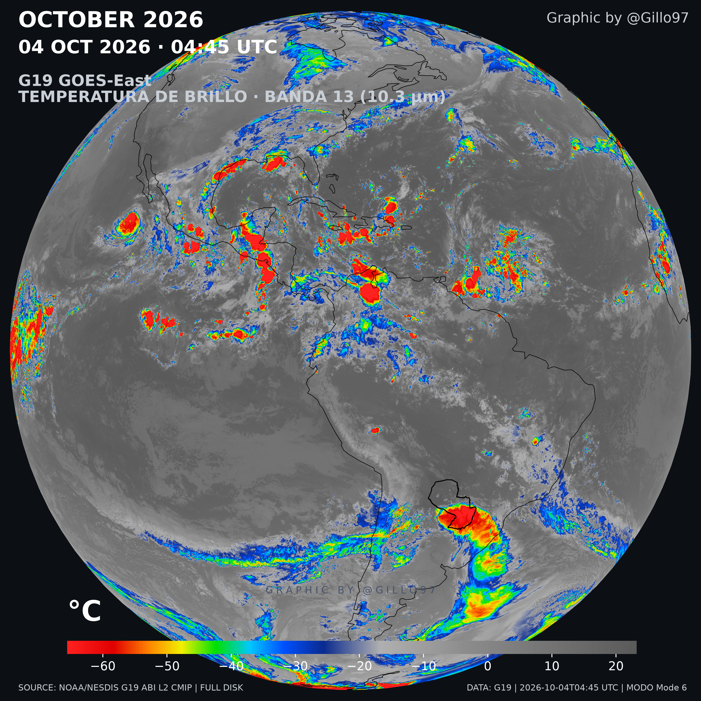

Animaciones y pósteres del clima con datos reales: **ERA5** (reanálisis) y
**GOES-R ABI** (satélite). Todo se renderiza local con matplotlib + cartopy en un
estilo de afiche — fondo oscuro, barra de color fina al pie, rótulos discretos.
No hay servicios ni cuentas de por medio: bajás el dato y lo dibujás.

## Las cuatro etapas

El repo está separado por **rol**, y se lee en el orden en que se usa:

| Carpeta | Qué hace | ¿Internet? |
| --- | --- | --- |
| [`descargar/`](./descargar) | Baja los datasets (NOAA S3, Copernicus CDS, NASA GIBS) | **Sí** |
| [`prototipos/`](./prototipos) | Pósteres e imágenes fijas, y los notebooks originales | No |
| [`cuadros/`](./cuadros) | Renderiza una animación cuadro por cuadro | No |
| [`animar/`](./animar) | Junta los cuadros en un MP4 o un GIF | No |

### Scripts por etapa

| Etapa | Scripts |
| --- | --- |
| `descargar/` | `descargar_goes.py`, `descargar_era5.py`, `descargar_himawari.py`, `truecolor_goes.py`, `geocolor.py`, `mur_sst.py`, `truecolor.py`, `sandwich.py`, `pace_landvi.py`, `precipitacion_ecmwf.py`, `anomalia_2t_ecmwf.py`, `viento_250_mslp.py` |
| `prototipos/` | `poster_goes.py`, `poster_goes_realista.py`, `poster_goes_truecolor.py`, `poster_goes_disco.py`, `poster_mur_realista.py`, `animar_mur_realista.py`, `poster_pace.py`, `poster_pace_gibs.py`, `poster_anomalia.py`, `poster_follaje.py`, `vista_paraguay.py` |
| `cuadros/` | `cuadros_goes.py`, `cuadros_c13_ir.py`, `cuadros_himawari_ir.py`, `cuadros_geocolor.py`, `cuadros_mur.py`, `cuadros_truecolor.py`, `cuadros_sandwich.py`, `cuadros_follaje.py`, `cuadros_follaje_globo.py`, `cuadros_precipitacion.py`, `cuadros_anomalia_2t.py`, `cuadros_viento_250.py` |
| `animar/` | `armar.py` |

El catálogo completo, flujo por flujo —qué baja cada script, qué póster produce, cómo se
anima y qué se verificó— está en [`docs/FLUJOS.md`](./docs/FLUJOS.md).

Los tres últimos scripts de cada fila son **pares de ECMWF**: cada descargador escribe una
serie `.npz` y su render la convierte en globo.
`descargar/precipitacion_ecmwf.py` y `cuadros/cuadros_precipitacion.py` aceptan
`--modelo {ifs,aifs-ens,aifs-single}`; `descargar/anomalia_2t_ecmwf.py` y
`cuadros/cuadros_anomalia_2t.py` aceptan `--modelo {ifs,aifs-single}`.

Aparte, [`comun/`](./comun) guarda lo compartido (rutas y constantes de estilo), también sin
red.

**Sólo `descargar/` necesita conexión.** Todo lo demás trabaja sobre lo ya bajado, así que
podés renderizar y animar sin internet.

Si es tu primera vez, andá a [`GUIA.md`](./GUIA.md): ahí está el flujo completo explicado paso
a paso.

## Dónde viven los datos

Los `.nc` pesan varios GB y las salidas también, así que **no van al repo**. La raíz de datos
la define un solo archivo, [`comun/rutas.py`](./comun/rutas.py), y por defecto apunta a
`D:\Users\guill\dataset era5`.

Si tus datos están en otro lado, no toques código:

```powershell
$env:CLIMATE3D_DATOS = "D:\mi\carpeta\datos"
```

## Qué se puede lograr

Quince salidas del mismo pipeline, todas con datos reales. En
[`docs/galeria/`](./docs/galeria) están las demás.

### GeoColor (GOES-East): color real de día, IR y luces de ciudad de noche

El mismo globo, el mismo día, a las 16:50 y a las 04:00 UTC:

| Día · 16:50 UTC | Noche · 04:00 UTC |
| --- | --- |
| 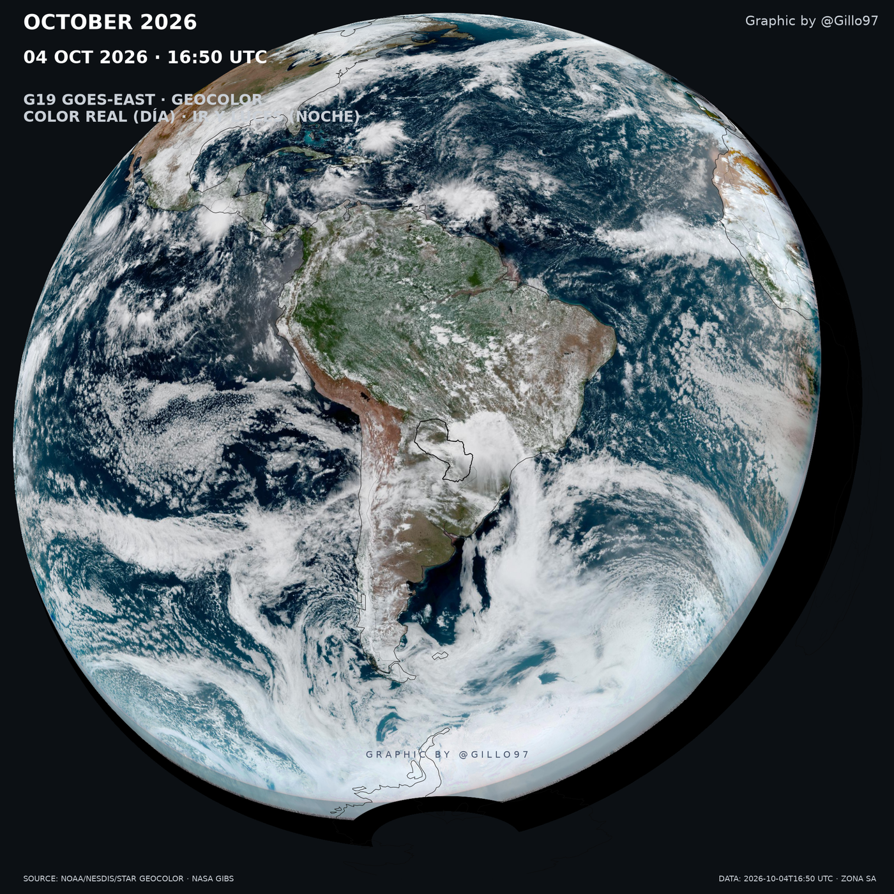 | 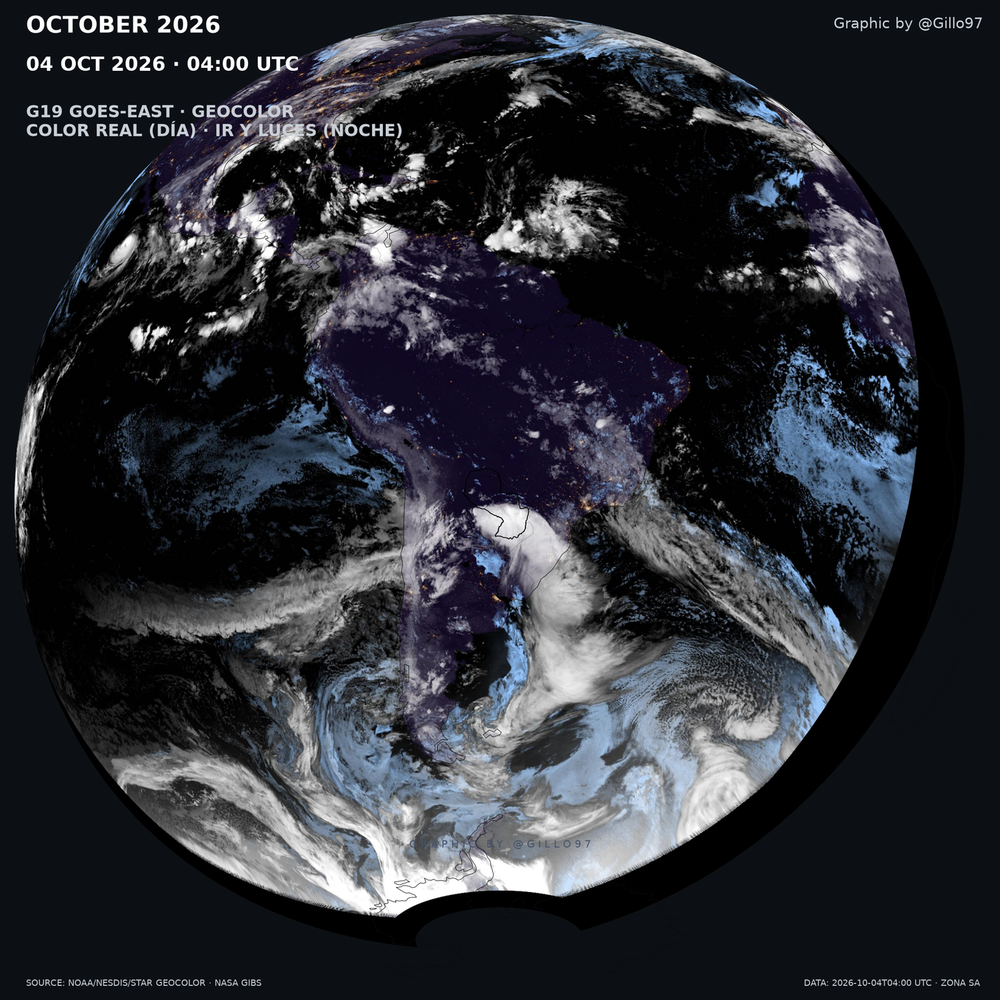 |

GeoColor no es una banda: es un producto RGB ya mezclado. **De día** se ve color real —la
Amazonía en verde, los Andes en ocre, el océano y las nubes tal como los vería el ojo—.
**De noche** el terreno da paso al infrarrojo, que separa las nubes bajas de agua líquida
(azul claro) de las altas de hielo (gris y blanco), y por encima van las **luces de ciudad**:
esas motas anaranjadas sobre la costa de Brasil y los Andes. Se baja de NASA GIBS, así que no
hay `.nc` que leer.

### Anomalía de temperatura (ERA5): el mes contra su propia climatología

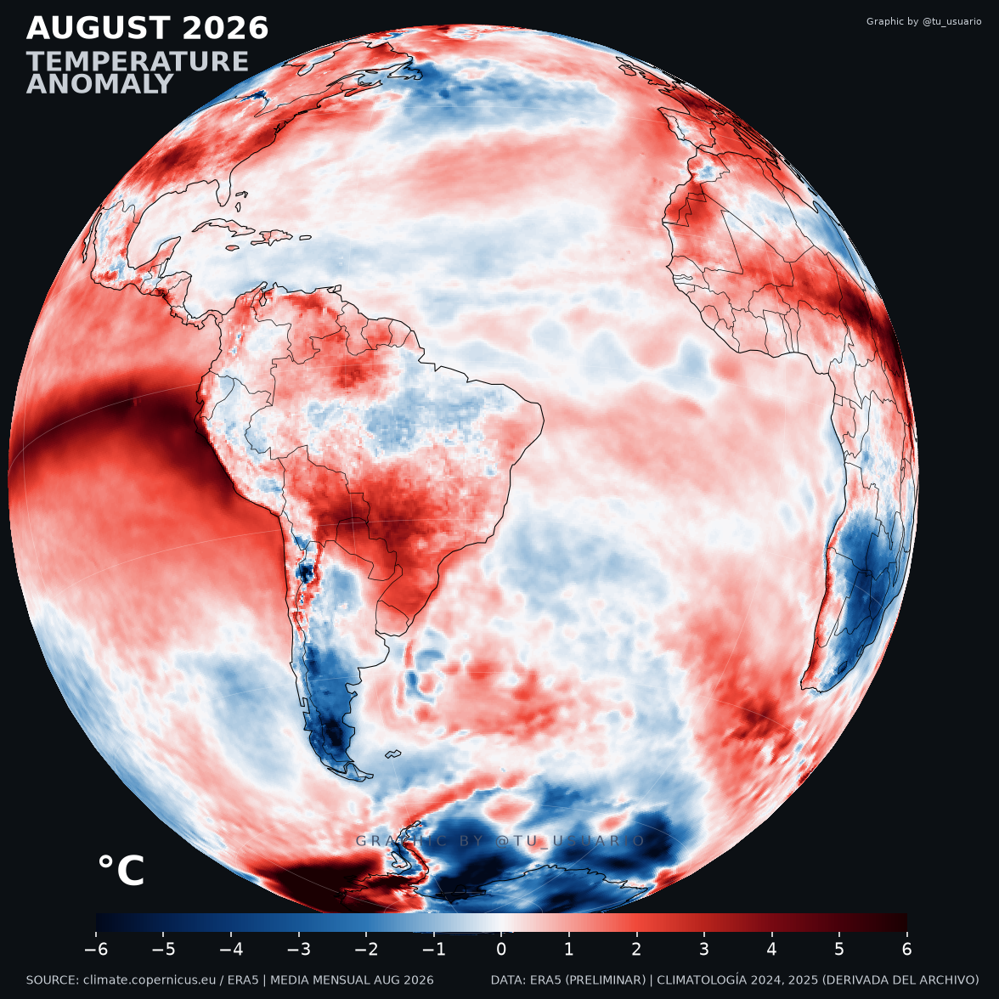

Cada mes se compara contra la climatología de ese mismo mes calculada con **los otros años**
del archivo. El rojo es más calor que lo normal, el azul menos.

### Cirrus C04 (GOES-West): reflectancia en 1.4 µm

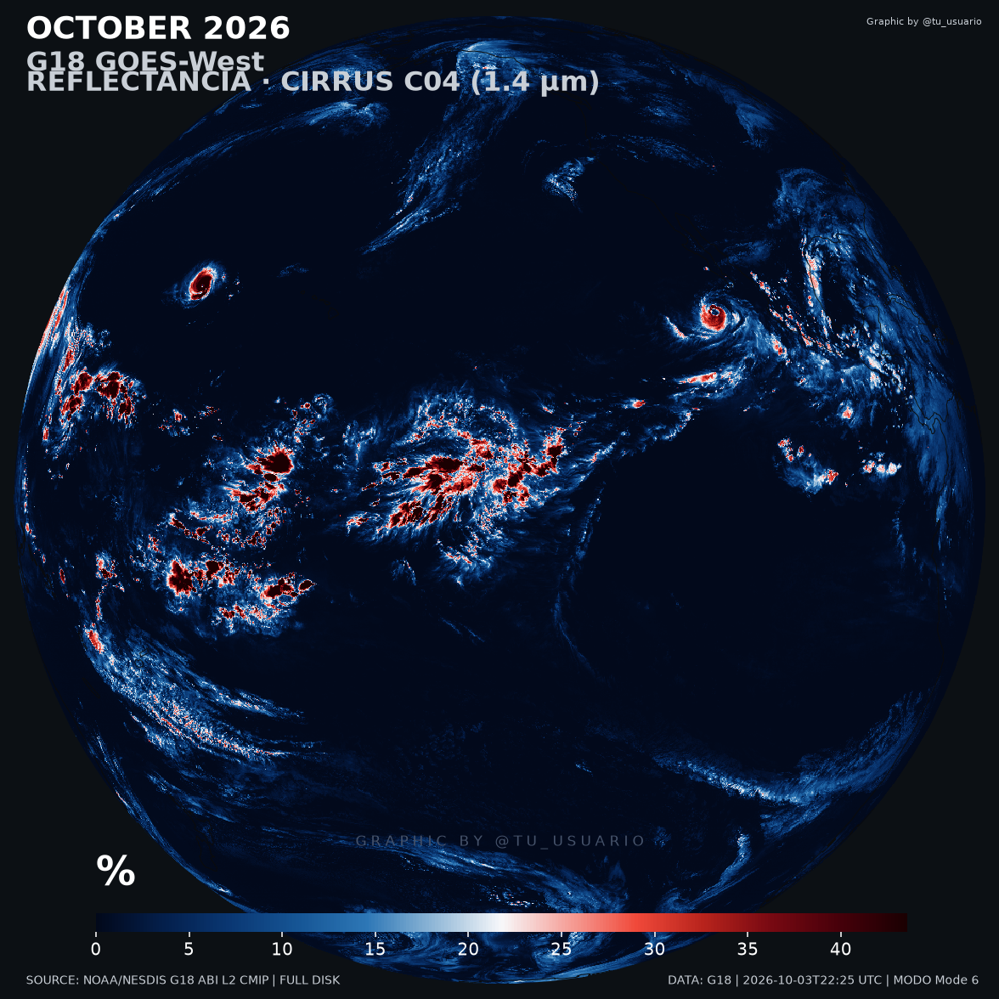

La banda de cirrus aísla las nubes altas de hielo y las despega del resto de la escena: los
topes convectivos aparecen en rojo sobre un fondo casi negro.

### C13 realista (GOES-19): el disco en clave Earth Observatory

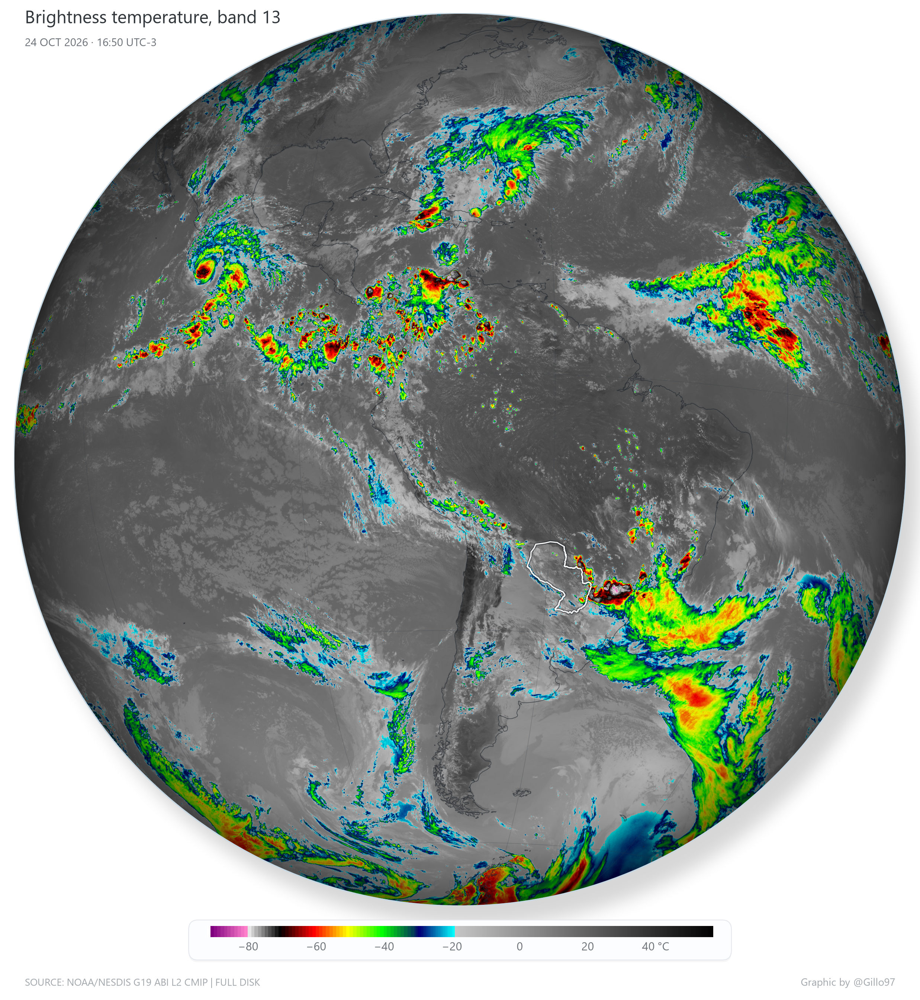

El mismo infrarrojo de la portada, pero con el vestuario del póster MUR: fondo blanco, globo
Orthographic inscripto, sombra exterior, retícula tenue y una tarjeta de leyenda con la
distribución. El gris es la superficie y las nubes bajas; el color, los topes fríos. La escala
es la **física de la rampa** (`-92.1` a `56.9 °C`), no percentiles, así que una serie de 144
cuadros no cambia de color entre cuadro y cuadro. Lo dibuja
[`prototipos/poster_goes_realista.py`](./prototipos/poster_goes_realista.py), que también
acepta `--frames` para armar la animación.

### Anomalía de SST (MUR): el Pacífico ecuatorial, semana a semana

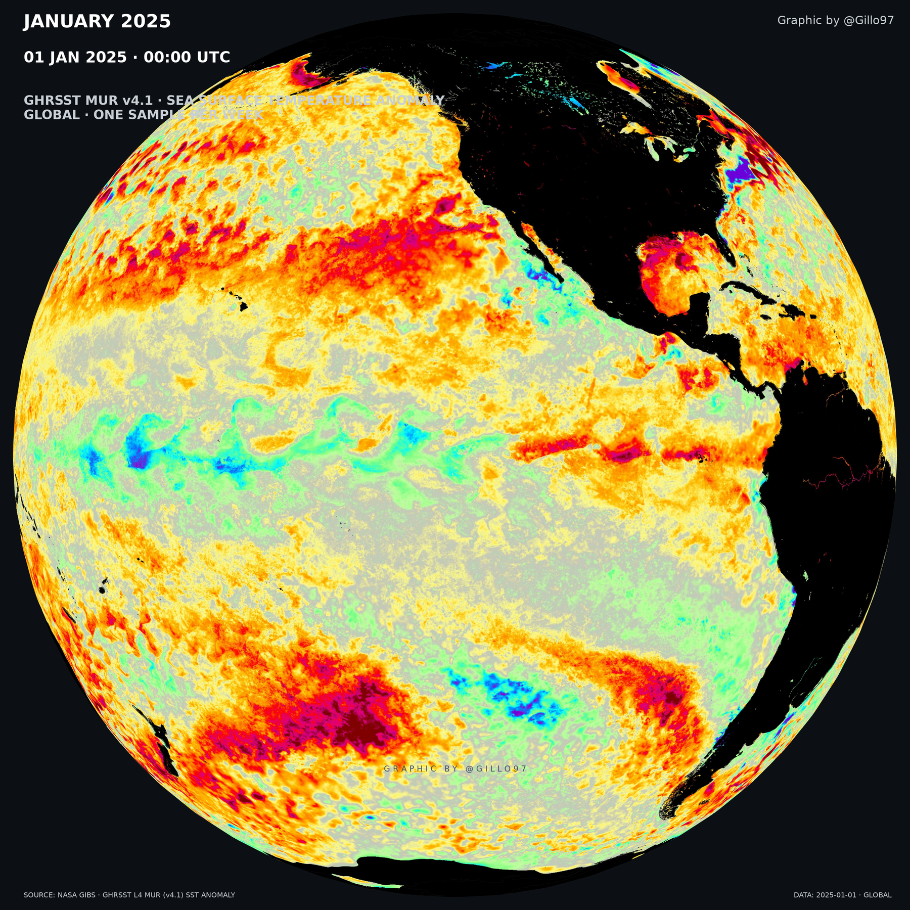

El producto **GHRSST MUR (v4.1) Sea Surface Temperature Anomalies** es global y diario. Acá
se anima **una muestra por semana**: del 2025-01-01 al 2026-10-17 son **94 cuadros**. El globo
es Orthographic y está centrado en la **región Niño 3.4 corrida al este** (`-125 0`), así
Sudamérica entra por el borde derecho. Las anomalías cálidas van en naranja y rojo, las frías
en cian y azul, y la tierra y los polos quedan enmascarados en negro. Se baja de **NASA GIBS**
(Worldview Snapshots API), igual que GeoColor: no hay `.nc` que leer. Los scripts son
[`descargar/mur_sst.py`](./descargar/mur_sst.py) y [`cuadros/cuadros_mur.py`](./cuadros/cuadros_mur.py).

### True Color (VIIRS): el humo de los incendios de 2024

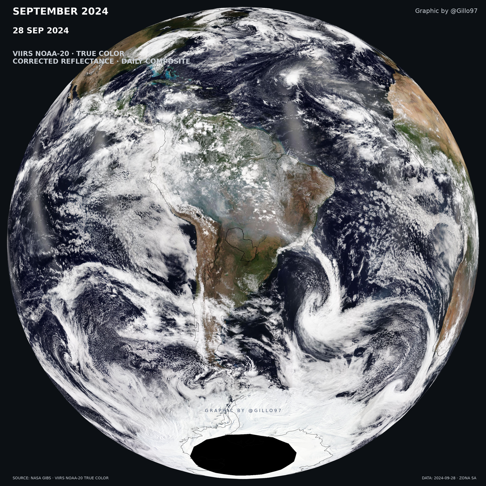

Es la **Corrected Reflectance (True Color)** de **VIIRS NOAA-20** vía NASA GIBS, a **250 m** y
con composición **diaria**. El remate va del 2024-07-11 al 2024-10-30: **112 cuadros** en globo
Orthographic sobre Paraguay. **Por qué no GeoColor**: esa capa en GIBS sólo tiene ventana
reciente (arranca el 2026-08-10), no hay archivo 2024. Y GOES-16 no publica ningún producto de
color real: habría que componer bandas a mano. **Por qué NOAA-20 y no MODIS**: los MODIS
(Terra y Aqua) dejan **cuñas negras de barrido** sobre el ecuador porque su ancho de barrido es
menor que la separación orbital; VIIRS NOAA-20 no. Los scripts son
[`descargar/truecolor.py`](./descargar/truecolor.py) y [`cuadros/cuadros_truecolor.py`](./cuadros/cuadros_truecolor.py).

### Color real de GOES-19: tres bandas, sin inventar el verde

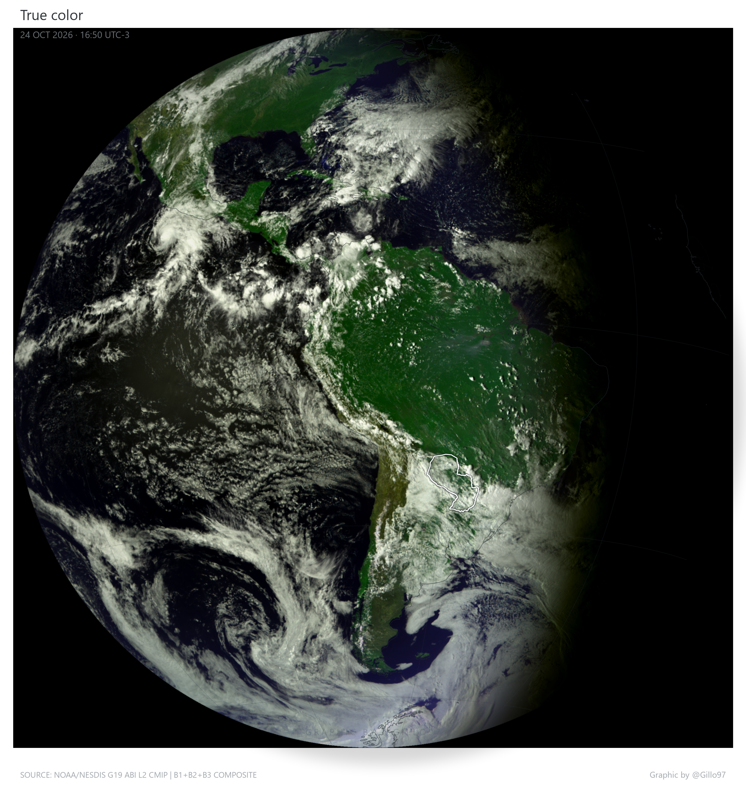

El ABI **no tiene banda verde**: para ver color real hay que bajar tres canales —`C01`
(0.47 µm), `C02` (0.64 µm) y `C03` (0.86 µm)— y sintetizar el verde con la receta de
CIMSS/Unidata (`0.45·rojo + 0.10·veggie + 0.45·azul`). El peso bajo del "veggie" es a
propósito: mide clorofila, no luz verde, y usarlo al 45 % pinta la Patagonia de esmeralda.
Con una sola banda visible —lo único que lleva HRIT— no hay color posible. Los scripts son
[`descargar/truecolor_goes.py`](./descargar/truecolor_goes.py) y
[`prototipos/poster_goes_truecolor.py`](./prototipos/poster_goes_truecolor.py); el mismo
slot en la **grilla nativa** del satélite, sin reproyectar, sale con
[`prototipos/poster_goes_disco.py`](./prototipos/poster_goes_disco.py).

### Sandwich RGB (GOES-19): la textura de las nubes sobre su temperatura

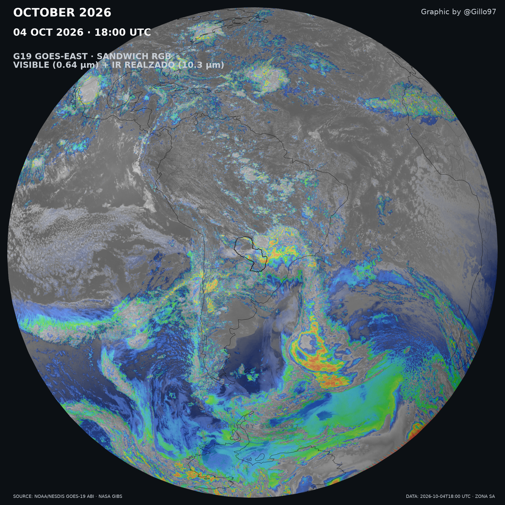

El Sandwich **no es un RGB de tres bandas**: junta **dos imágenes**. El **visible (0.64 µm)**
pone la *morfología* del tope nuboso —las sombras que delatan un *overshooting top*, ondas de
gravedad, plumas de hielo— y el **IR de 10.3 µm realzado en color** pone la *temperatura* de
ese tope. Se mezclan 50/50 y queda una sola imagen: el color dice cuán frío (y alto) está el
tope, el gris del visible dice qué forma tiene. Es **de día**: sin sol el visible es negro, así
que se animan los **tramos diurnos del 4 y 5 de octubre de 2026** (10:00 a 22:00 UTC, paso 10
min) → **146 cuadros** en globo Orthographic sobre Paraguay. Se compone a partir de dos capas de
**NASA GIBS** (`GOES-East_ABI_Band2_Red_Visible_1km` y `GOES-East_ABI_Band13_Clean_Infrared`),
no de los `.nc`: el ABI **C02 a 0.5 km pesa ~200 MB por archivo**, inviable para cientos de
cuadros. Como GOES-East no ve el hemisferio centrado en Paraguay entero, el disco se dibuja con
`--radio` (~53°) para que el borde entre dentro de lo que ve el satélite y no quede un gajo sin
dato. Los scripts son [`descargar/sandwich.py`](./descargar/sandwich.py) y
[`cuadros/cuadros_sandwich.py`](./cuadros/cuadros_sandwich.py).

### Dust, Air Mass y Fire Temperature (GOES-19): tres RGB oficiales en globo

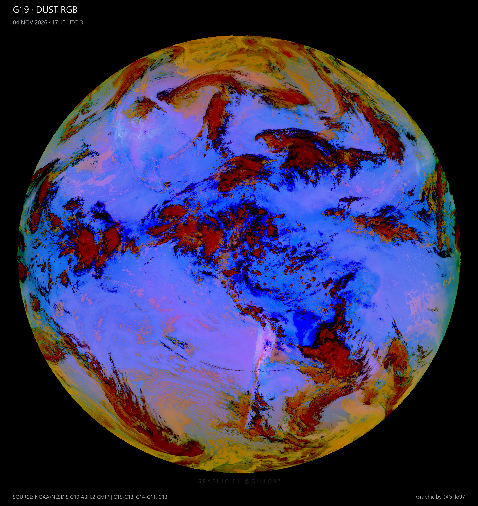

Tres productos RGB del ABI, cada uno con **su propia receta** (bandas, rango y gamma del
quick guide de NOAA) y su propia lectura del color. No comparten la rampa de C13: un RGB
no es una banda coloreada, son tres canales mezclados, y la receta *es* la paleta.

| Producto | R | G | B | Qué se ve |
| --- | --- | --- | --- | --- |
| **Dust** | C15−C13 | C14−C11 (γ2.5) | C13 | Polvo en magenta/rosa; de noche, violeta bajo 3 km |
| **Air Mass** | C08−C10 | C12−C13 | C08 invertida | Aire polar azul/violeta, tropical verde, seco oliva/naranja |
| **Fire Temperature** | C07 (γ0.4) | C06 | C05 | Fuego de rojo a blanco según intensidad; cicatrices marrón |

Los tres se dibujan con el mismo globo del color real (centro subsatelital, fondo oscuro,
sin retícula ni costas) y comparten los controles de GOES: ventana, últimos N cuadros,
snapshot de una hora/minuto exactos y animación. Las bandas se bajan con
[`descargar/descargar_goes_rgb.py`](./descargar/descargar_goes_rgb.py) y el render vive en
[`prototipos/poster_goes_rgb.py`](./prototipos/poster_goes_rgb.py); la tabla de recetas,
en [`comun/rgb_goes.py`](./comun/rgb_goes.py).

> **Ojo con Fire Temperature**: usa las bandas visibles/near-IR, así que de noche las
> nubes vienen negras. Es un producto diurno para incendios, no un IR de 24 h.

### "Solo Paraguay" y "Últimos datos": dos controles transversales

Todos los productos que miran la Tierra (salvo el Snapshot, que ya es Paraguay; el MUR,
que es SST oceánica; y el follaje, que usa otro globo) tienen dos controles que no
dependen del producto:

- **Solo Paraguay**: encuadra la captura o la animación en las coordenadas del país, con
  el **margen** que elijas (0-20 %). GeoColor y los modelos (precipitación, anomalía y
  viento) lo resuelven como mapa plano cuadrado; los GOES, como un zoom del globo. Todos
  salen en **captura limpia**: sin títulos, créditos, halo, leyenda, costas ni aro, con el
  contorno del país dibujado. Himawari, MUR y follaje no la tienen.
- **Últimos datos**: ignora la ventana de fechas y resuelve los N cuadros más nuevos
  publicados. En los GOES la cadencia es de 10 min y la lista es la misma para todos
  (10, 12, 24, 36, 48, 60). GeoColor se resuelve contra GIBS (que contesta una imagen
  negra cuando el slot no existe) y Himawari contra el bucket de NOAA.

El encuadre se calcula en [`comun/paraguay.py`](./comun/paraguay.py) y el margen se
traduce a `--radio` (grados) o `--recorte` (fracción del hemisferio) según el render.

### Focos de calor (FIRMS): los incendios encima de la captura

NASA FIRMS publica **detecciones puntuales** de calor (no imágenes) de los satélites que
pasan sobre el área. Con el toggle **Focos de calor (FIRMS)** la captura sale con esos
puntos encima, alineados con la misma proyección que dibuja el contorno del país.

**Configuración (una sola vez).** La API exige un MAP_KEY gratuito:

1. Pedilo en <https://firms.modaps.eosdis.nasa.gov/api/map_key/> (email + un click).
2. Guardalo en `datos/firms_map_key.txt` (está en `.gitignore`), o exportá `FIRMS_MAP_KEY`.

Sin clave el servicio contesta `400 Invalid MAP_KEY` y el job avisa; nunca se commitea la
clave.

**Dónde se puede usar**: Snapshot de Paraguay, GeoColor (recorte y globo), Fire Temperature
y Color real de 3 bandas (globo y disco nativo).

**Los tres controles:**

- **Sensor**: `VIIRS` NOAA-20 + NOAA-21 (375 m reales, el que tiene sentido a 250 m/px),
  `MODIS` (1 km, detecta menos), `Suomi NPP` (publica de forma intermitente) y `Landsat`,
  que **sólo cubre EE.UU. y Canadá**: para Sudamérica devuelve la cabecera sin filas.
- **Focos a mostrar**: `Todos los del área` o `Sólo los de Paraguay`. El segundo filtra por
  el **polígono** del país, no por la caja; en el globo, además, baja ~25 veces menos datos.
- **Ventana**: `Día UTC` (el compuesto diario *es* ese día), `±3/6/12 h` alrededor del cuadro
  y `24 h / 2 / 3 / 5 días` hacia atrás, como el *time based* del visor de FIRMS.

**Tres cosas que conviene saber:**

- VIIRS pasa sobre Paraguay cerca de las **05 y las 17 UTC**. Una ventana de `±3 h` a
  mediodía puede traer **0 focos**: no es un fallo, es cuándo mira el satélite.
- La API acepta **5 días por pedido**; ventanas más largas se piden en tandas.
- El tamaño del punto sigue la **gravedad** (FRP: baja, moderada, alta, extrema) y el color
  la **confianza** del sensor. En zonas densas se dibuja **un punto por celda** (el más
  energético): con un hemisferio en llamas, dibujar los ~39.000 visibles tapaba el mapa;
  agrupados quedan ~3.700 sin que se note el recorte.

Si FIRMS no responde, no hay focos o falta la clave, la captura sale **sin overlay** con un
aviso en el log: un proveedor externo no rompe el job.

### Himawari-9 AHI B13 (Clean Infrared): el ciclón del mar Filipino

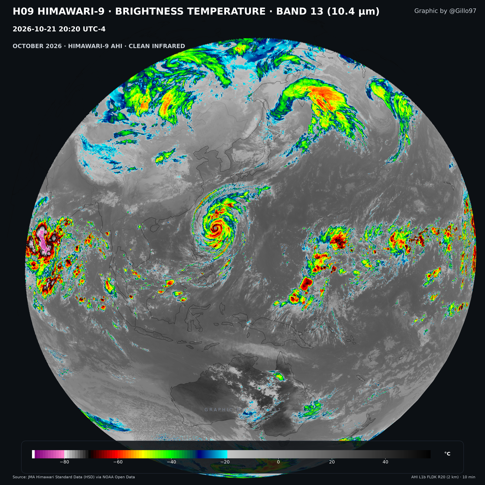

La serie hermana de la de GOES, pero del **satélite de Asia**. Es la **banda 13 del AHI de
Himawari-9** (infrarrojo ventana, 10.4 µm) a **2 km** y **10 min**, del 20 al 22 de
octubre de 2026 → **288 cuadros** en globo Orthographic centrado en el **mar Filipino**
(`133 17`), con el ciclón cerca de Taiwan en el centro.

Dos diferencias con la serie GOES, y las dos importan:

- **La rampa no es la del repo**: es la **Clean Infrared de NASA Worldview / GIBS**
  (`Clean_Longwave_Infrared_Window_Band`), la misma que usan las capas
  `GOES-East_ABI_Band13_Clean_Infrared` y `Himawari_AHI_Band13_Clean_Infrared`. Se copió
  del colormap oficial de GIBS (237 bins) y se verificó contra la leyenda real de
  Worldview. Está en [`comun/paleta_gibs.py`](./comun/paleta_gibs.py).
- **El dato no viene en NetCDF**: es **HSD** (Himawari Standard Data), un formato binario
  propio de JMA, así que [`descargar/descargar_himawari.py`](./descargar/descargar_himawari.py)
  también lo decodifica (cabecera de 11 bloques en little-endian, 10 franjas del disco,
  calibración de JMA a temperatura de brillo).

Los rótulos van en **hora de Paraguay (UTC-4)**. Los scripts son
[`descargar/descargar_himawari.py`](./descargar/descargar_himawari.py) y
[`cuadros/cuadros_himawari_ir.py`](./cuadros/cuadros_himawari_ir.py).

---

### Precipitación total acumulada (ECMWF): 144 h de lluvia sobre Sudamérica

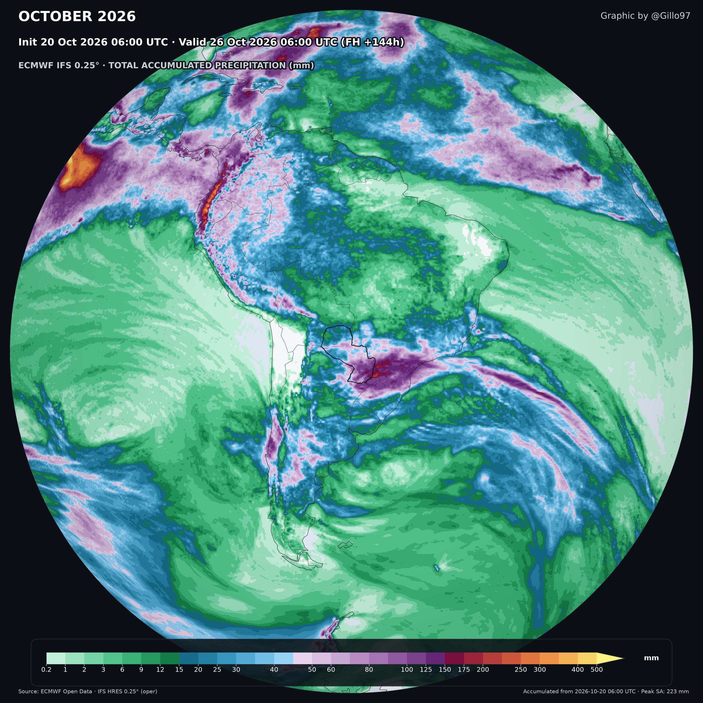

El **acumulado total de precipitación (`tp`)** de **ECMWF IFS 0.25°** (`oper`) no es una
imagen satelital: es un campo del modelo. La corrida `06z` del 20 de octubre de 2026 cubre
**0 a 144 h** (hasta el 26 de octubre, 06z) en pasos de **3 h**: **49 cuadros** en globo
Orthographic centrado en Paraguay. `tp` viene acumulado desde el inicio de la corrida en
metros de agua equivalente, así que se convierte a **mm** y se pinta con la **paleta discreta
de 30 niveles** de Tropical Tidbits (`0.2` a `500+ mm`), con sombreado esférico 3D, costas,
fronteras y el contorno de Paraguay. El póster de cierre (`FH +144 h`) muestra el máximo sobre
Paraguay y el sur de Brasil. En vez de bajar los ~4,8 GB de GRIB2 de los 49 pasos, el
descargador lee el `.index` de cada paso y pide **sólo el rango de bytes** de `tp`/`sfc`:
~20 MB en total. Los scripts son
[`descargar/precipitacion_ecmwf.py`](./descargar/precipitacion_ecmwf.py) y
[`cuadros/cuadros_precipitacion.py`](./cuadros/cuadros_precipitacion.py).

### Precipitación del ensamble AIFS-ENS: 360 h de lluvia hasta el 4 de noviembre

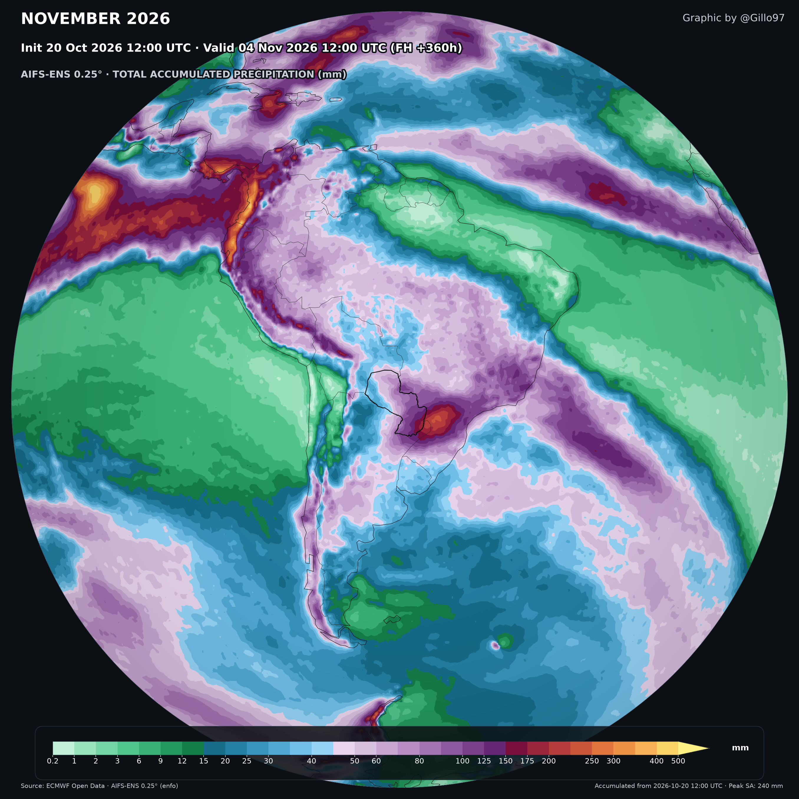

El **AIFS-ENS** es el **ensamble** del modelo de IA de ECMWF: publica el **control (`cf`)** y
**50 miembros perturbados (`pf`)** en archivos separados, y el campo que se pinta es la
**media** de `cf` más 10 `pf` equiespaciados. La corrida `12z` del 20 de octubre de 2026
cubre **0 a 360 h** (hasta el 4 de noviembre, 12z) en pasos de **6 h**: **61 cuadros** en
globo Orthographic centrado en Paraguay. El acumulado del ensamble llega a ~**226 mm** sobre
el este de Paraguay y el sur de Brasil en el paso `+360 h`, y se pinta con la misma **paleta
discreta de 30 niveles** de Tropical Tidbits (`0.2` a `500+ mm`) que el determinístico.

Ojo con las unidades: el **IFS publica `tp` en metros (`m`)** y el **AIFS en `kg m**-2`**
(numéricamente igual a mm). El descargador lee el `units` de cada mensaje y escala, así que
los tres modelos quedan en la misma escala. Es el mismo par de scripts, con
`--modelo aifs-ens`.

### Anomalía de temperatura a 2 m (ECMWF): el pronóstico contra la climatología de ERA5

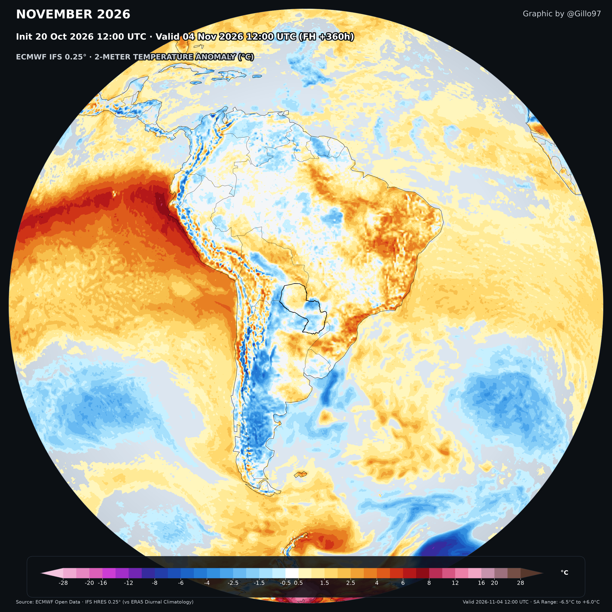

La **anomalía de temperatura a 2 m** (`2t`) del **ECMWF IFS 0.25°** se calcula contra una
**climatología diurna** hecha con **ERA5**: para cada mes y cada hora UTC (`00`, `06`, `12`,
`18`) se promedia el período 2024–2026 del archivo local `era5_t2m_2024-2026.nc`, que se lee
con **h5py** —sin `xarray`. La corrida `12z` del 20 de octubre de 2026 cubre **0 a 360 h**
en pasos de **6 h**: **61 cuadros** en globo Orthographic.

La paleta es **divergente y discreta** (Tropical Tidbits, de `-28` a `+28 °C`): violetas y
azules para el frío, amarillos y rojos para el cálido. La **banda neutra `[-0.5, +0.5] °C`
queda transparente**, así que en las zonas sin anomalía se ve la superficie base del globo
(océano, tierra y sombreado esférico) en vez de un parche blanco. El campo se interpola en
**mes** y en **hora**, así que el paso del 31 de octubre al 1 de noviembre no tiene salto. Los
scripts son [`descargar/anomalia_2t_ecmwf.py`](./descargar/anomalia_2t_ecmwf.py) y
[`cuadros/cuadros_anomalia_2t.py`](./cuadros/cuadros_anomalia_2t.py).

### Viento en 250 mb y extremos de presión (ECMWF): la troposfera alta

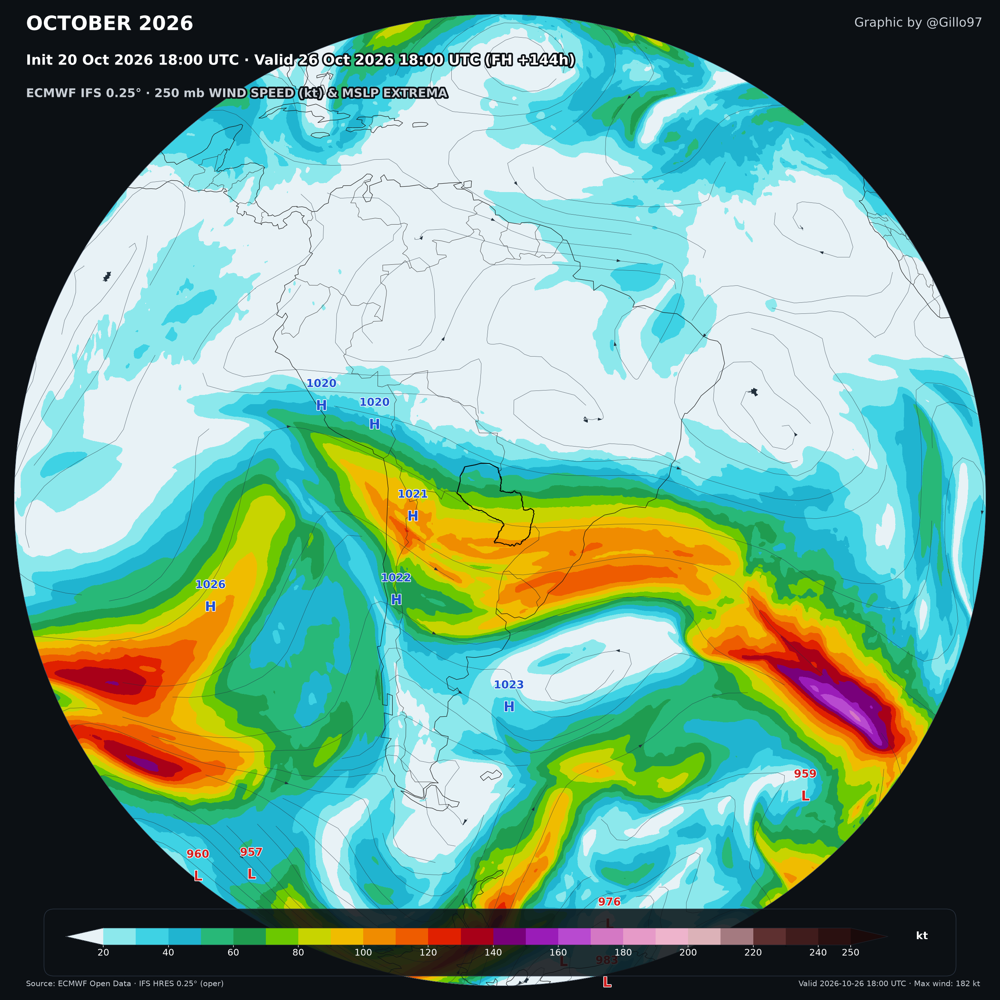

El **viento en 250 mb** (`u` y `v` en el nivel de 250 hPa) del **ECMWF IFS 0.25°** es la
troposfera alta: la **velocidad** se pinta con una **escala discreta de 10 kt de 20 a 250**
(cian → verde → amarillo → naranja → rojo → bordó → violeta → magenta → rosa → marrón) y
encima van las **streamlines**, con puntas de flecha triangulares, que muestran la dirección
del flujo. La corrida `18z` del 20 de octubre de 2026 cubre **0 a 144 h** en pasos de
**6 h**: **25 cuadros** en globo Orthographic.

Encima se marcan los **extremos de la presión a nivel del mar** (`msl`): `L` en **rojo** para
los lows y `H` en **azul** para los highs, con el valor en hPa. Sólo cuentan los más
significativos (`L` por debajo de `1002 hPa`, `H` por encima de `1016 hPa`) y los que caen
dentro del disco. El viento máximo global llega a ~**182 kt** y la presión va de ~**947** a
~**1046 hPa**. Los scripts son
[`descargar/viento_250_mslp.py`](./descargar/viento_250_mslp.py) y
[`cuadros/cuadros_viento_250.py`](./cuadros/cuadros_viento_250.py).

---

### Follaje de otoño (PACE/OCI): cazar hojas rojas desde el espacio

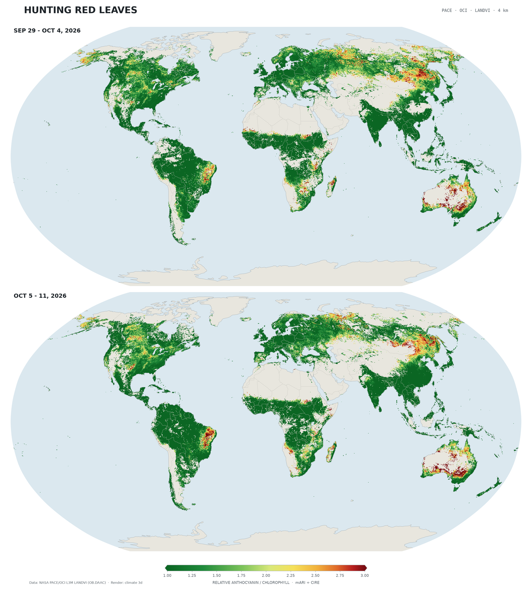

Dos semanas del **índice de rojez de la vegetación** medido por el **OCI de PACE**: del
**29 de setiembre al 4 de octubre** y del **5 al 11 de octubre de 2026**. La escala va de
**1.00 a 3.00** y es la **antocianina sobre la clorofila** (`mari ÷ cire`): cerca de 1 la
copa tiene tanto rojo como verde (todavía no cambió), y por encima de 2 el rojo domina. Los
rojos de Siberia, el norte de Canadá y Alaska de la primera semana se corren hacia el sur en
la segunda, y aparecen en Australia, el sur de África y el cinturón agrícola de Brasil.

El dato **no sale de GIBS**: son los gránulos **L3M LANDVI** de OB.DAAC a **4 km** y diarios,
que traen diez índices de vegetación por archivo y **ya vienen enmascarados para nubes**.
Cada día pesa ~170 MB y **exige Earthdata Login**, así que es la única rama del repo que
necesita cuenta. El póster promedia los índices de la semana y recién después divide —al
revés deja mucho más ruido—, y dibuja en **Robinson** sobre fondo blanco. Los scripts son
[`descargar/pace_landvi.py`](./descargar/pace_landvi.py) y
[`prototipos/poster_follaje.py`](./prototipos/poster_follaje.py).

También hay **dos animaciones** de la temporada completa (del 7 de agosto al 11 de octubre
de 2026, 66 cuadros, cada uno compuesto móvil de 7 días): una en mapa plano
([`cuadros/cuadros_follaje.py`](./cuadros/cuadros_follaje.py)) y otra en **globo
Orthographic realista que rota**: arranca en el Pacífico ecuatorial, da una vuelta entera y
usa el relieve del Blue Marble para que el planeta no se vea plano
([`cuadros/cuadros_follaje_globo.py`](./cuadros/cuadros_follaje_globo.py), con
[`comun/globo3d.py`](./comun/globo3d.py) para la base y el warp).

### PACE en color real: el mismo satélite del follaje, otra mirada

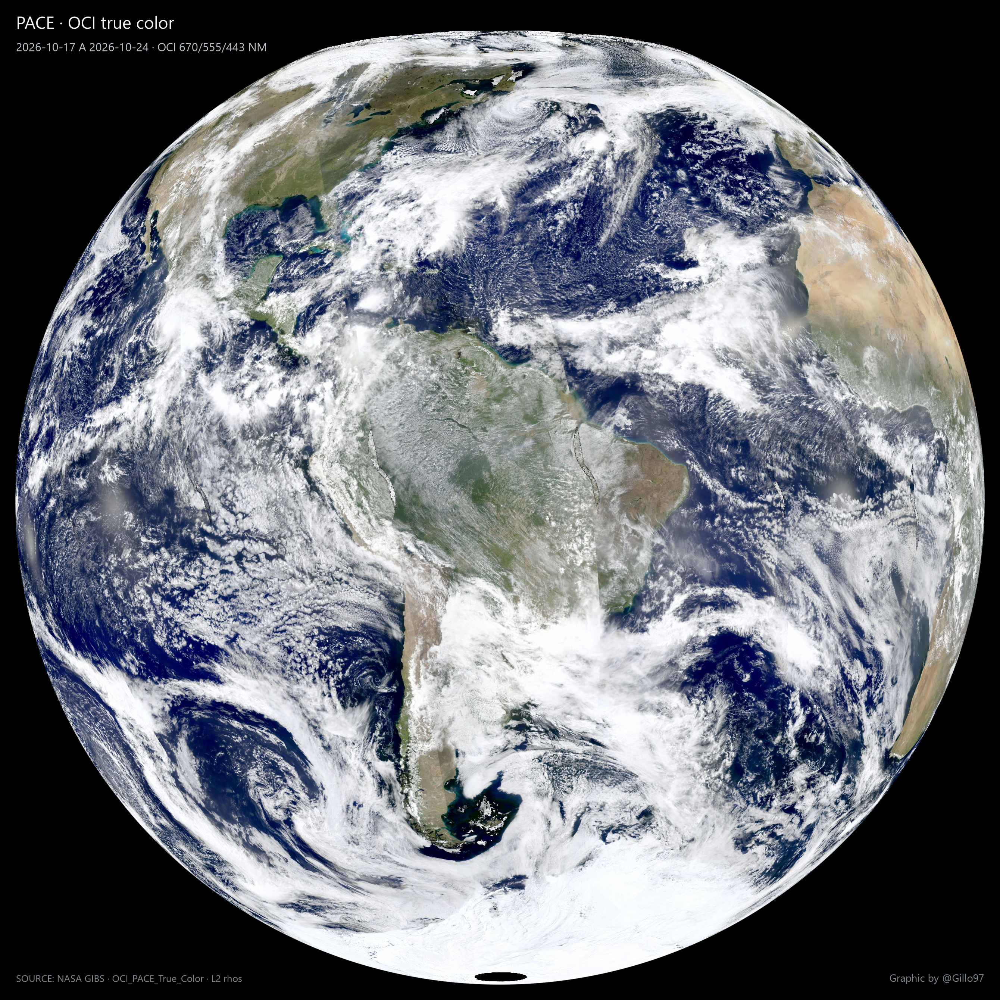

PACE no sólo mide índices de vegetación: su **OCI** también ve color. A diferencia del ABI,
tiene **banda verde real (555 nm)**, así que el RGB es (670, 555, 443) medido y no hay verde
sintético. Este póster usa el compuesto oficial **OCI_PACE_True_Color** de NASA GIBS
(`--dias 8`), que trae nubes, aerosoles y sombras; el camino alternativo,
[`prototipos/poster_pace.py`](./prototipos/poster_pace.py), lee un L3M SFREFL crudo con las
bandas medidas, pero al ser reflectancia de superficie las nubes vienen enmascaradas. El
script del compuesto es [`prototipos/poster_pace_gibs.py`](./prototipos/poster_pace_gibs.py).

## Requisitos

- Python 3.14 y el entorno `.venv` de la raíz.
- Las dependencias están fijadas en [`requirements.txt`](./requirements.txt).

```powershell
.venv\Scripts\python.exe -c "import cartopy, matplotlib, requests, PIL, eccodes, h5py; print('ok')"
```

`eccodes` hace falta para los GRIB2 de ECMWF y `h5py` para leer el NetCDF/HDF5 de ERA5
sin `xarray`.

## Primeros pasos

```powershell
# 1) Bajar los cuadros más nuevos (o sin flags: las últimas 24 h UTC)
.venv\Scripts\python.exe descargar\descargar_goes.py --ultimos 10

# 2) Un póster fijo de disco completo
.venv\Scripts\python.exe prototipos\poster_goes.py --paleta clean_ir

# 3) Renderizar esos cuadros de la animación (globo centrado en Paraguay, 720 px)
.venv\Scripts\python.exe cuadros\cuadros_goes.py --sat G19 --banda C13 --ultimos 10 `
    --px 720 --globo --centro -73 -18 --paleta clean_ir

# 4) Armar el MP4
.venv\Scripts\python.exe animar\armar.py --frames "D:\Users\guill\dataset era5\salidas\frames_G19_2026-10-02T0000_432f_720px" --fps 12.5
```

Cada etapa imprime al terminar **el comando de la siguiente**, así que en la práctica alcanza
con arrancar por la 1.

## Ruta rápida: precipitación ECMWF en 3 pasos

El flujo completo del globo de **precipitación total acumulada** (49 cuadros de `2712x2712 px`):

```powershell
# 1) Descargar tp de la corrida 06z del 20 de octubre de 2026 (0h a 144h, paso 3h)
.venv\Scripts\python.exe descargar\precipitacion_ecmwf.py --fecha 2026-10-20 --ciclo 06 --hasta-hora 144 --paso 3

# 2) Renderizar los 49 cuadros y el póster de cierre FH +144 h (2712 px)
.venv\Scripts\python.exe cuadros\cuadros_precipitacion.py --fecha 2026-10-20 --ciclo 06 --hasta-hora 144 --paso 3

# Sólo el póster, sin la secuencia
.venv\Scripts\python.exe cuadros\cuadros_precipitacion.py --fecha 2026-10-20 --ciclo 06 --hasta-hora 144 --paso 3 --solo-poster

# 3) Armar el MP4
.venv\Scripts\python.exe animar\armar.py --frames "D:\Users\guill\dataset era5\salidas\frames_precipitacion_globo_2026-10-20T0600_49f_2712px" --fps 12.5
```

El póster queda en `SALIDAS/poster_precip_ecmwf_2026-10-20_06z_fh144.png` y los cuadros en la
carpeta `frames_precipitacion_globo_...` que imprime el paso 2.

El mismo par de scripts sirve para los otros dos modelos: agregá `--modelo aifs-ens` (media
del ensamble AIFS) o `--modelo aifs-single` (AIFS determinístico) a **los dos** comandos. El
nombre del póster y de la carpeta de cuadros cambian con el modelo, así que una corrida no
pisa a la otra.

## El formato

Todas las salidas comparten el mismo vestuario, así que un póster, un cuadro de animación o
una vista regional se leen igual:

- El **crédito** (`Graphic by @Gillo97`) va arriba a la derecha y repetido como marca de agua.
  Se cambia con `--credito`.
- Debajo del título va la **fecha y hora del cuadro, grande**: es lo primero que uno quiere
  leer.
- El **contorno de Paraguay** se dibuja negro y fino (0.8 pt), sutil sobre el mapa. Se activa
  con `--geojson` y se apaga con `--sin-borde`.
- **Paletas**: `clean_ir` (la de GIBS, escala fija), `termico`, `anomalia`, `gris`, `magma`,
  `inferno`, `turbo`.

En las animaciones los rótulos escalan **sub-linealmente** con la resolución: si escalaran
linealmente, a 2048 px el título se comería el cuadro.

## Notas

- Los `.nc`, `.gif` y `.log` están ignorados; las imágenes de `docs/` se exceptúan a
  propósito.
- Las animaciones salen en **MP4** con el ffmpeg que trae `imageio-ffmpeg` — no hace falta
  tenerlo en el PATH. El GIF queda para el loop universal, pero a alta resolución y muchos
  cuadros pesa cientos de MB.
- Los slots GOES son cada 10 min (modo 6) y la hora sale del nombre del archivo, no la
  escribas a mano. Ojo: el `t` del producto cae unos 5 min después del inicio del escaneo,
  así que un archivo que arranca a las 04:40 se rotula 04:45.
- **cartopy baja shapefiles de Natural Earth la primera vez** que dibuja costas. Ese primer
  render necesita internet aunque el resto del paso no; después quedan cacheados.
