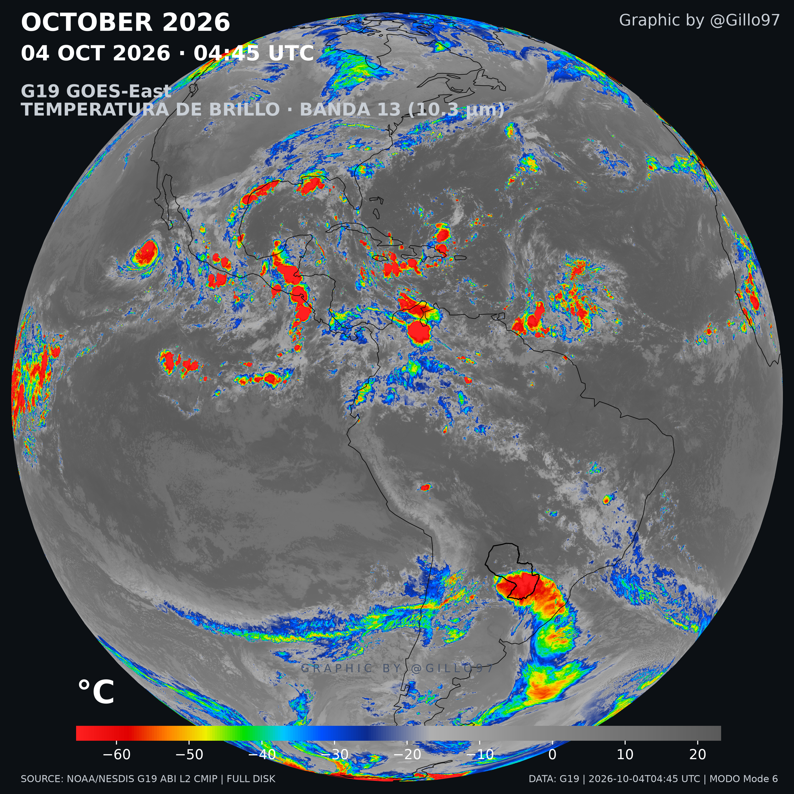
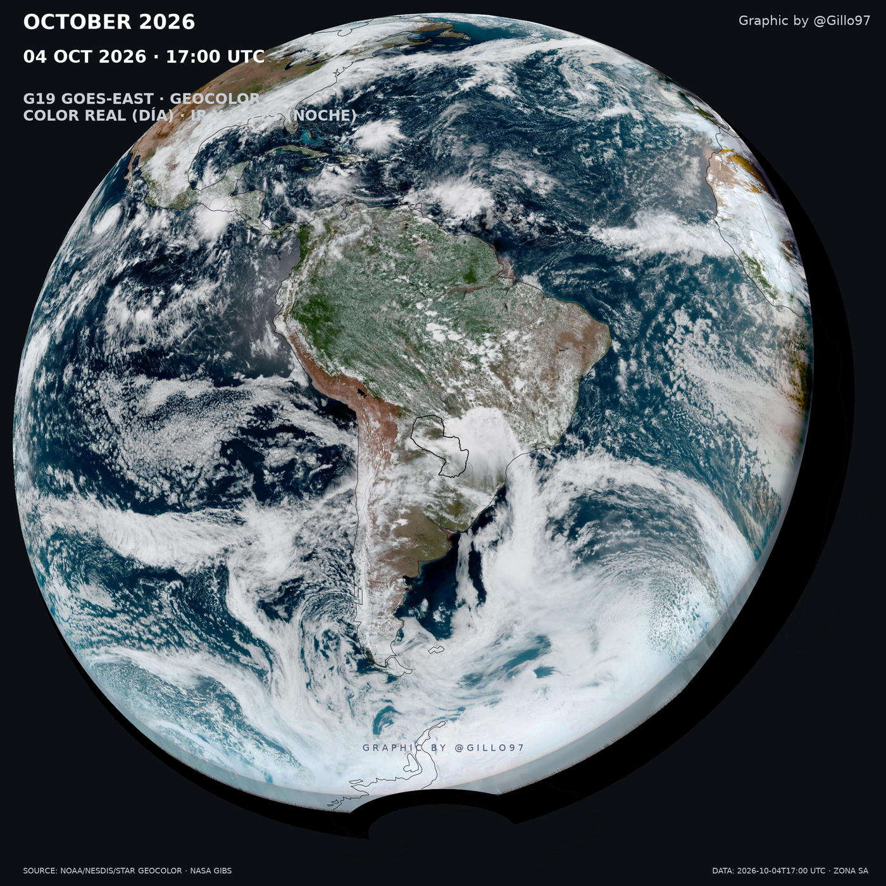
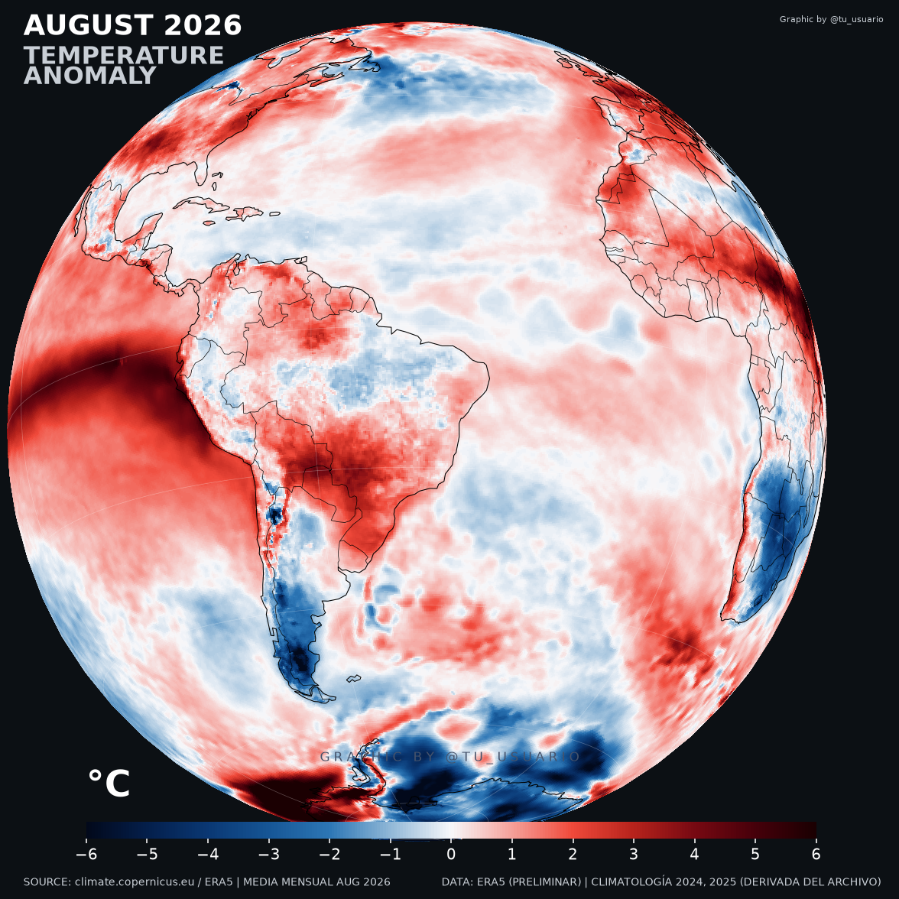
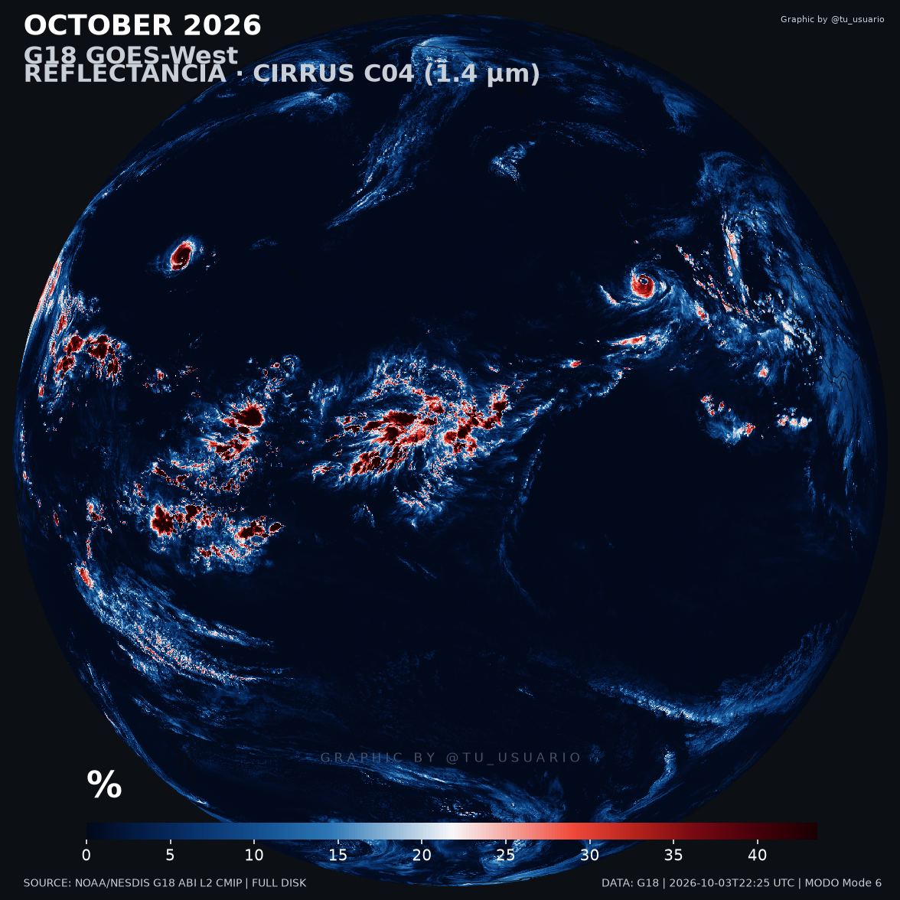

# Climate 3D



Animaciones y pósteres del clima con datos reales: **ERA5** (reanálisis) y
**GOES-R ABI** (satélite). Todo se renderiza local con matplotlib + cartopy en un
estilo de afiche — fondo oscuro, barra de color fina al pie, rótulos discretos.
No hay servicios ni cuentas de por medio: bajás el dato y lo dibujás.

## Las cuatro etapas

El repo está separado por **rol**, y se lee en el orden en que se usa:

| Carpeta | Qué hace | ¿Internet? |
| --- | --- | --- |
| [`descargar/`](./descargar) | Baja los datasets (NOAA S3, Copernicus CDS, NASA GIBS) | **Sí** |
| [`prototipos/`](./prototipos) | Pósteres e imágenes fijas, y los notebooks originales | No |
| [`cuadros/`](./cuadros) | Renderiza una animación cuadro por cuadro | No |
| [`animar/`](./animar) | Junta los cuadros en un MP4 o un GIF | No |

Aparte, [`comun/`](./comun) guarda lo compartido (rutas y constantes de estilo), también sin
red.

**Sólo `descargar/` necesita conexión.** Todo lo demás trabaja sobre lo ya bajado, así que
podés renderizar y animar sin internet.

Si es tu primera vez, andá a [`GUIA.md`](./GUIA.md): ahí está el flujo completo explicado paso
a paso.

## Dónde viven los datos

Los `.nc` pesan varios GB y las salidas también, así que **no van al repo**. La raíz de datos
la define un solo archivo, [`comun/rutas.py`](./comun/rutas.py), y por defecto apunta a
`D:\Users\guill\dataset era5`.

Si tus datos están en otro lado, no toques código:

```powershell
$env:CLIMATE3D_DATOS = "D:\mi\carpeta\datos"
```

## Qué se puede lograr

Cuatro salidas del mismo pipeline, todas con datos reales. En
[`docs/galeria/`](./docs/galeria) están las demás.

### GeoColor (GOES-East): color real de día, IR y luces de ciudad de noche

Dos cuadros consecutivos de una animación (10 minutos entre uno y otro):

| 04 OCT 2026 · 16:50 UTC | 04 OCT 2026 · 17:00 UTC |
| --- | --- |
|  |  |

GeoColor no es una banda: es un producto RGB ya mezclado. De día se ve color real —la
Amazonía en verde, los Andes en ocre, el océano y las nubes tal como los vería el ojo— y de
noche el terreno da paso al infrarrojo con las **luces de ciudad** encima. Se baja de NASA
GIBS, así que no hay `.nc` que leer.

### Anomalía de temperatura (ERA5): el mes contra su propia climatología



Cada mes se compara contra la climatología de ese mismo mes calculada con **los otros años**
del archivo. El rojo es más calor que lo normal, el azul menos.

### Cirrus C04 (GOES-West): reflectancia en 1.4 µm



La banda de cirrus aísla las nubes altas de hielo y las despega del resto de la escena: los
topes convectivos aparecen en rojo sobre un fondo casi negro.

## Requisitos

- Python 3.12 y el entorno `.venv` de la raíz.
- `numpy`, `xarray`, `matplotlib`, `cartopy`, `Pillow` y `rich`. Para ERA5, además `cdsapi`.

```powershell
.venv\Scripts\python.exe -c "import cartopy, xarray, rich; print('ok')"
```

## Primeros pasos

```powershell
# 1) Bajar un dataset (GOES-East C13, 3 días)
.venv\Scripts\python.exe descargar\descargar_goes.py --sat G19 --banda C13 --desde 2026-10-02 --hasta 2026-10-05

# 2) Un póster fijo de disco completo
.venv\Scripts\python.exe prototipos\poster_goes.py --paleta ir_realce

# 3) Renderizar los cuadros de la animación (globo centrado en Paraguay, 432 a 720 px)
.venv\Scripts\python.exe cuadros\cuadros_goes.py --sat G19 --banda C13 --desde 2026-10-02 `
    --n 432 --px 720 --globo --centro -73 -18 --paleta ir_realce

# 4) Armar el MP4
.venv\Scripts\python.exe animar\armar.py --frames "D:\Users\guill\dataset era5\salidas\frames_G19_2026-10-02T0000_432f_720px" --fps 12.5
```

Cada etapa imprime al terminar **el comando de la siguiente**, así que en la práctica alcanza
con arrancar por la 1.

## El formato

Todas las salidas comparten el mismo vestuario, así que un póster, un cuadro de animación o
una vista regional se leen igual:

- El **crédito** (`Graphic by @Gillo97`) va arriba a la derecha y repetido como marca de agua.
  Se cambia con `--credito`.
- Debajo del título va la **fecha y hora del cuadro, grande**: es lo primero que uno quiere
  leer.
- El **contorno de Paraguay** se dibuja negro y fino (0.8 pt), sutil sobre el mapa. Se activa
  con `--geojson` y se apaga con `--sin-borde`.
- **Paletas**: `ir_realce` (IR con color en los topes fríos), `termico`, `anomalia`, `gris`,
  `magma`, `inferno`, `turbo`.

En las animaciones los rótulos escalan **sub-linealmente** con la resolución: si escalaran
linealmente, a 2048 px el título se comería el cuadro.

## Notas

- Los `.nc`, `.gif` y `.log` están ignorados; las imágenes de `docs/` se exceptúan a
  propósito.
- Las animaciones salen en **MP4** con el ffmpeg que trae `imageio-ffmpeg` — no hace falta
  tenerlo en el PATH. El GIF queda para el loop universal, pero a alta resolución y muchos
  cuadros pesa cientos de MB.
- Los slots GOES son cada 10 min (modo 6) y la hora sale del nombre del archivo, no la
  escribas a mano. Ojo: el `t` del producto cae unos 5 min después del inicio del escaneo,
  así que un archivo que arranca a las 04:40 se rotula 04:45.
- **cartopy baja shapefiles de Natural Earth la primera vez** que dibuja costas. Ese primer
  render necesita internet aunque el resto del paso no; después quedan cacheados.
